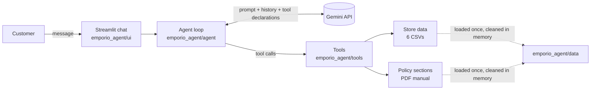

# music-store-ai-agent

Python AI agent for music store customer support, using Gemini function calling and a Streamlit chat.

## 1. Overview

A text-message customer service agent for **Empório da Música**, a (fictional) musical instrument store in Campo Grande/MS. It speaks Brazilian Portuguese with the store's persona, answers questions about **products, prices, stock, promotions, payment options and orders** by querying the store's data, and answers questions about **opening hours, returns, shipping, warranty and payment rules** by querying the store's policy manual. It redirects out-of-scope requests (accessories, homework, general chat) and never invents prices, stock or rules.

The LLM decides *what* to look up; deterministic Python functions decide *what is true*.

## 2. Quick start

Requirements: [uv](https://docs.astral.sh/uv/getting-started/installation/) (it installs Python 3.12 for you).

```bash
uv sync                                   # install dependencies
cp .env.example .env                      # then set GEMINI_API_KEY in .env
uv run streamlit run app.py               # open the chat at http://localhost:8501
```

- **API key:** create a free Gemini API key at <https://aistudio.google.com/apikey> and paste it into `.env`.
- **Model:** `gemini-3.5-flash-lite` by default (`GEMINI_MODEL` in `.env`). See [Model and provider](#model-and-provider) for why.
- **Simulated date:** `.env.example` sets `STORE_NOW=2026-03-25T10:30`. Keep it: the dataset is frozen in March 2026 (see [Reference date](#reference-date-and-time)).

**Or with Docker** (no local Python or uv needed), after creating `.env` as above:

```bash
docker compose up --build                 # then open http://localhost:8501
```

The image installs exactly what `uv.lock` pins; `.env` is passed at runtime and never copied into the image.

Other commands:

```bash
uv run pytest                                  # 118 offline tests (no API key, no LLM calls)
uv run ruff check && uv run ruff format --check
uv run python scripts/generate_examples.py     # regenerate examples/ with the real model
uv run python scripts/generate_examples.py 3   # only scenario 3
```

## 3. Architecture



Each customer message goes to the **agent loop**, which sends the system prompt, the conversation history and the six tool declarations to Gemini. When the model asks for a tool, the agent runs the matching Python function and sends the result back; this repeats until the model answers in text (at most 5 model calls per turn). Every tool call is logged and shown in the UI under each reply ("🔧 Consultas realizadas"), so it is visible **when the agent queried data and when it queried policies**.

| Package | Responsibility |
|---|---|
| `emporio_agent/data/` | Load the CSVs and the PDF once; clean and correct them in memory (`data/` files stay untouched). |
| `emporio_agent/tools/` | Business rules, one module per domain: catalog, promotions, products, orders, payments, policy search, plus a registry. |
| `emporio_agent/agent/` | The only package that knows about the LLM: system prompt and the function-calling loop. |
| `emporio_agent/ui/` | Streamlit chat. Renders and forwards messages; no business logic. |

Dependencies point one way: `ui → agent → tools → data`. Swapping the LLM provider touches only `agent/`; a new business rule touches one module in `tools/`.

### The tools

| Tool | Use | Kind |
|---|---|---|
| `search_products` | Catalog search with category, text and price filters; cheapest first, max 10, with `total_matches` / `truncated` | Data |
| `get_product_details` | One product: exact price, availability, specs, active and expired promotions, alternatives if unavailable | Data |
| `get_active_promotions` | Current promotions with original price, discount % and promotional price | Data |
| `get_order_status` | One order, only after an identity check; pre-computed day counts | Data |
| `calculate_payment_options` | PIX price and interest-free installments under the manual's rules | Rules (computed) |
| `search_policies` | The 1–2 most relevant sections of the policy manual | Policies |

## 4. Technical decisions

### Agent approach
**What:** native function calling with a small, hand-written loop (`emporio_agent/agent/agent.py`, ~200 lines).
**Why:** the questions need *exact* answers (a price, a stock level, an order status), which deterministic functions over tabular data give and generation does not. A visible loop makes every decision loggable and testable: the loop is unit-tested with a scripted fake client.
**Rejected:** LangChain/LangGraph/LlamaIndex/CrewAI (more abstraction than a six-tool agent needs, harder to explain and debug) and RAG over the CSVs (semantic search is the wrong tool for "how much is product X").

### Model and provider
**What:** Google Gemini through the official `google-genai` SDK, model `gemini-3.5-flash-lite`, temperature 0.3, configurable via `GEMINI_MODEL`.
**Why:** Gemini has a free tier, so evaluators can run the project at no cost, and solid function calling; a low temperature keeps answers consistent. The model choice was driven by the free tier, found the hard way:
- `gemini-3.8-flash` (first choice) and then `gemini-3.6-flash` both allow only **20 requests per day** for free. A customer turn takes 2–3 model calls, so that is about 8 turns a day: not enough to generate the five examples, let alone to evaluate the chat. Both hit the daily cap during development.
- `gemini-3.5-flash-lite` (Google's recommended Lite model for new projects) allows about **500 requests per day** and 10 per minute for free. The heavy lifting (searching, matching, arithmetic, dates) is done by the tools, so the model mainly has to pick the right tool and phrase the answer, which a Lite model handles: the examples in `examples/` were all generated with it.
- With a paid key, `GEMINI_MODEL=gemini-3.8-flash` works unchanged.
**Rejected:** a provider abstraction layer (YAGNI for a prototype; the `agent/` package is the seam where one would go).

### Policy retrieval
**What:** the PDF is extracted once, cleaned, corrected and split into its **ten numbered sections**; `search_policies` scores them with accent-insensitive keywords and returns the best 1–2 sections whole.
- Extraction uses pypdf's `layout` mode: the default mode returns one word per line.
- The repeated header and `Página N` footer are stripped.
- Top-level headings are detected at column 0. This avoids a trap: the numbered list inside section 7.2 has an item `3. Consulta:` that starts a page and would otherwise look like section 3.
- Scoring: title match ×3, body match ×1, plus a short, documented synonym table for customer words that are not in the manual (`abrem` → hours, `estorno` → returns, `quebrou` → warranty). Words are compared by their first 5 letters (a crude Portuguese stemmer: `devolver` ↔ `devoluções`).
- Contradictions in the manual are fixed by an explicit `POLICY_CORRECTIONS` mapping applied at load time (see [Assumptions](#5-assumptions)). Loading fails fast if a correction no longer matches the PDF, or if splitting does not produce sections 1–10.

**Why:** ten coherent sections are small enough to return whole, so chunking and embeddings add nothing but dependencies; keyword search is deterministic, testable (13 real customer questions are in the tests) and shows exactly which policy the answer came from.
**Rejected:** a vector store (overkill for ten documents), and pasting the whole manual into the prompt (8 pages per call, and it hides which policy was used).

### Data handling
**What:** the six CSVs are loaded once with pandas into a frozen `StoreData` dataclass, validated (expected columns) and cleaned in memory. The tools index them by ID into plain dicts.
- `specs` JSON strings are parsed into dicts.
- Descriptions that name a different brand than the product name are dropped (a generic `KNOWN_BRANDS` check, no hard-coded IDs; 6 products are affected).
- Availability is defined once: `status == "active" and stock_quantity > 0`.
- Missing values become `None` and dates become `date` objects, so tool results are valid JSON.
- Matching is case-, accent- and punctuation-insensitive (`GD-20` = `GD20`), with `difflib` suggestions for typos and a rough Portuguese singular (`violões` → `violão`) so categories match by name *and* description (`saxofone` finds the wind-instrument category).

**Why:** the data has real quality issues (see `docs/data_notes.md`), and fixing them at load time keeps `data/` untouched and every fix visible in code.

### Deterministic payment and date calculations
**What:** `calculate_payment_options` computes the PIX price and the maximum interest-free installments; `get_order_status` returns `days_since_purchase`, `days_since_receipt` and `is_delayed` / `days_late`. Promotional prices are computed in the tools. Money is rounded half-up to cents with `Decimal`.
**Why:** LLMs are unreliable at arithmetic and date math, and the manual says wrong prices can amount to misleading advertising. Example: the R$ 899.00 Tagima Woodstock allows **8x**, not 9x, because 9x would be R$ 99.89, under the R$ 100.00 minimum. The tool gets this right; a model doing mental math often does not.
**Trade-off:** the payment numbers (5% PIX, installment tiers, R$ 2,000 combination threshold) are duplicated from the manual as named constants in `config.py`, each citing its section. Arithmetic accuracy matters more here than a single source of truth. Return *eligibility* is deliberately **not** hard-coded: the tool returns facts (dates, elapsed days) and the model applies the policy text, so the manual stays the single source for those rules.

### Conversation history
**What:** in memory, per conversation. The `Agent` owns the history; the UI keeps one `Agent` per browser session in `st.session_state`, so conversations never leak between users. "Nova conversa" starts a fresh agent.
**Why:** enough for a prototype. **Rejected:** Redis or a database (listed under next steps).

### Interface
**What:** a minimal Streamlit chat. Each reply has a collapsed "🔧 Consultas realizadas" expander listing the tool calls (labelled 📦 Catálogo, 🚚 Pedido, 📋 Políticas…) with arguments and a result summary. The sidebar shows the simulated date, what the agent can help with, the model, and a reset button. A missing API key shows a clear setup message instead of a stack trace. The UI is tested offline with Streamlit's `AppTest` and a fake agent.
**Why:** a working chat with almost no front-end code, and the tool calls make the agent's reasoning auditable. **Rejected:** a custom web front end (time better spent on the agent).

### Language split
Code, comments, docs and this README are in **English**. Everything the customer sees is in **Brazilian Portuguese**: the system prompt and persona, the replies, the UI strings and the conversations in `examples/`. Tool results use English keys with pt-BR values where they reach the customer (`"status": "enviado"`).

### Privacy in order lookup
**What:** `get_order_status` requires the **order number plus the email or phone** used in the purchase, and compares it with *that order's* customer (email case-insensitive; phone by digits, with or without +55). A name alone is never accepted. A wrong contact and an unknown order get the **same** generic message, so the tool does not reveal which order numbers exist. Results include only the customer's first name and what they need about the order.
**Why:** the manual's privacy section (section 9) commits the store to the **LGPD** (Lei 13.709/2018). The data also makes names unsafe as identity: there are near-duplicate names (`Bruno Carvalho` vs. `Bruno Carvalho Martins`) and a duplicate email (customers 11 and 43).

### Reference date and time
**What:** a single `get_store_now()` (in `config.py`) is used by the tools and the system prompt. It reads `STORE_NOW` (`.env.example`: `2026-03-25T10:30`, a Wednesday during business hours, three days after the last order) and falls back to the real time in `America/Campo_Grande`. The prompt receives the weekday, date and time on every turn, so the agent knows "today" and whether the store is open.
**Why:** the dataset is frozen in March 2026. With the real date, recent orders would look stuck in "pending" for months and every return window would be long gone. The UI shows "Data simulada: 25/03/2026 10:30".

### Reliability
Transient Gemini errors (5xx, such as 503 "high demand") are retried by the SDK with exponential backoff. 429 is not retried: on the free tier it usually means the quota is used up, and retrying burns more of it. If the model never answers, an API call fails, or the turn exceeds 5 model calls, the customer gets a polite fallback in Portuguese and the history stays consistent. A tool that receives bad arguments returns `{"error": ...}` to the model instead of crashing.

## 5. Assumptions

Where the case or the data was ambiguous, the simplest reasonable reading was chosen and documented. Full details: [`docs/data_notes.md`](docs/data_notes.md).

**Contradictions in the policy manual** (fixed in `POLICY_CORRECTIONS`, `emporio_agent/data/policies.py`):

| Issue in the PDF | Resolution |
|---|---|
| WhatsApp `(67) 3321-4500` (section 7) vs. `(67) 3341-4444` (cover and company data table, labelled "Telefone / WhatsApp") | `(67) 3341-4444`: it appears twice, including in the official company data. |
| Email with an invalid accented domain, `contato@empóriodamusica.com.br` (1.2) | `contato@emporiodamusica.com.br`, as on the cover. |
| Payment table says "minimum installment R$ 100" for all credit payments vs. tiered rules in 3.1 | 3.1 is authoritative (more specific); the table only states the 12x limit. |
| "Up to 3x: no minimum installment (except below R$ 50.00)" | Read as a minimum installment of R$ 50.00 for 1x–3x. |

**Other ambiguities in the manual:**
- An order of exactly R$ 500.00 is covered by neither "free above R$ 500" nor "R$ 35 below R$ 500". No tool computes shipping; the agent quotes the rule as written.
- Defect exchanges end 30 days after purchase (4.2), while the legal warranty lasts 90 days from receipt (8.1). Both are presented: after 30 days, the warranty path (legal and manufacturer, with the store mediating) still applies.
- The 7-day preference exchange (4.3) has no stated start date. It is quoted as written.
- "Closed on holidays" comes with no holiday list, and "extended hours on special dates" with no dates. Neither is modeled.
- The manual names no partner stores, so the agent never suggests one.

**Data:**
- The CSV files are named `desafio_tecnico_ai_eng - <table>.csv` (with spaces); the exact names are constants in `config.py`.
- The CSV is the source of truth for the catalog: 65 products, although the manual claims "more than 300".
- Categories 6–8 (wind instruments, orchestral strings) have no products: reported as "not carried at the moment", never as "out of stock".
- `is_active` is the only promotion validity signal (promotions have no dates). If two active promotions hit one product, only the highest applies (not cumulative). A product that cannot be bought shows no active promotion (no rain check, manual 6.2).
- Product 136 is discontinued but still has stock: it is not sold. Product 130 is `coming_soon` but appears in two orders: reported as a data inconsistency; the order tool just reports the order.
- Six products (135–144) have a description that names a different brand, sometimes contradicting the specs: `name`, price, stock, status and `specs` are authoritative and those descriptions are dropped.
- Orders have no actual delivery date: for delivered orders, `estimated_delivery` is the **assumed receipt date** (flagged `receipt_date_is_estimated`). Orders have no sales channel: all are assumed **online** (they ship with tracking), so the regret right applies.
- `order_items` has no unit price, and two orders' totals differ from current prices (orders 3 and 20): `total_brl` is reported as the order total and never recomputed.
- Three historical orders (9, 16, 18) break today's installment minimums. They are assumed to predate manual v2.1, and the agent does not comment on past payment terms.
- Customers 11 and 43 share an email. Since that email really is on file for order 10's customer, it opens order 10 for either person; the phone tells them apart. Accepted as a known limitation.

## 6. Known limitations and next steps

- **Keyword policy search**: robust for ten sections and the tested questions, but phrasing far from the manual's words can miss. Next: embeddings or a hybrid search if the manual grows.
- **In-memory history**: lost on restart, single process. Next: Redis or a database, with retention rules (LGPD).
- **No real actions or handoff**: the agent informs but cannot open a ticket, cancel an order or transfer to a human. Next: a handoff tool integrated with the store's helpdesk.
- **No LLM evaluation suite**: the deterministic layer has 118 tests, but answer quality is checked only through the example conversations. Next: a set of scripted conversations with assertions on tool calls and key facts in the replies, run against each prompt change.
- **Free-tier limits**: about 10 requests per minute and 500 per day with `gemini-3.5-flash-lite`, so roughly 3–4 customer turns per minute. Above that, the customer gets the polite fallback reply. Next: a paid tier, or caching frequent policy answers.
- **Identity check**: order number + email/phone is a reasonable prototype, but a shared email is weak. Next: a one-time code sent to the registered phone.
- **Single provider**, **no WhatsApp integration**, **no holiday calendar**, **shipping quotes by CEP not available**.
- Model output is not deterministic: rerunning the examples gives different wording (the facts come from the tools and stay the same).
- A Lite model sometimes skips a nuance the tools provide. In example 4 it does not say that the receipt date is an *estimate* (the tool flags it with `receipt_date_is_estimated`), and in example 1 it silently fixes the catalog's "Cedr" typo to "Cedro". No price, stock, date or rule in the examples is wrong, but an evaluation suite (above) or a larger model would catch these.

## 7. Use of AI coding assistants

This project was built with **Claude Code** (Anthropic's coding agent, model Claude Opus 5.5) in VS Code.

- **Julio** defined the scope, the architecture constraints and the quality bar in [`CLAUDE.md`](CLAUDE.md), which is in the repository and documents the intended workflow. He reviewed and tested each phase before committing it himself, drove the structural refactors (splitting the tools into one module per domain, then grouping the code into `data/`, `tools/`, `agent/` and `ui/` packages for maintainability), proposed the Docker setup, and made the trade-off calls that came up along the way, such as switching to a model with a larger free tier when the Flash quotas proved too small.
- **Claude** inspected the data, wrote the code, tests and documentation following `CLAUDE.md`, ran the checks (`pytest`, `ruff`, `mypy`) and the live tests against Gemini, and surfaced problems found along the way for a decision: the PDF extraction issue, the extra description conflicts, the API rejecting `role="tool"`, and the free-tier quota.

The commit history follows the phases in `CLAUDE.md` section 9.

## 8. Examples

Real conversations generated by `scripts/generate_examples.py` with the real model (not edited), at `STORE_NOW=2026-03-25T10:30`:

1. [Catalog search with filters, then payment options](examples/01_product_search.md)
2. [Price lookup, expired and active promotions, out of stock](examples/02_price_lookup.md)
3. [Order status with identity verification](examples/03_order_status.md)
4. [Return request: order data combined with policy rules](examples/04_return_policy.md) (the non-trivial one)
5. [Out of scope requests and store information](examples/05_out_of_scope.md)
